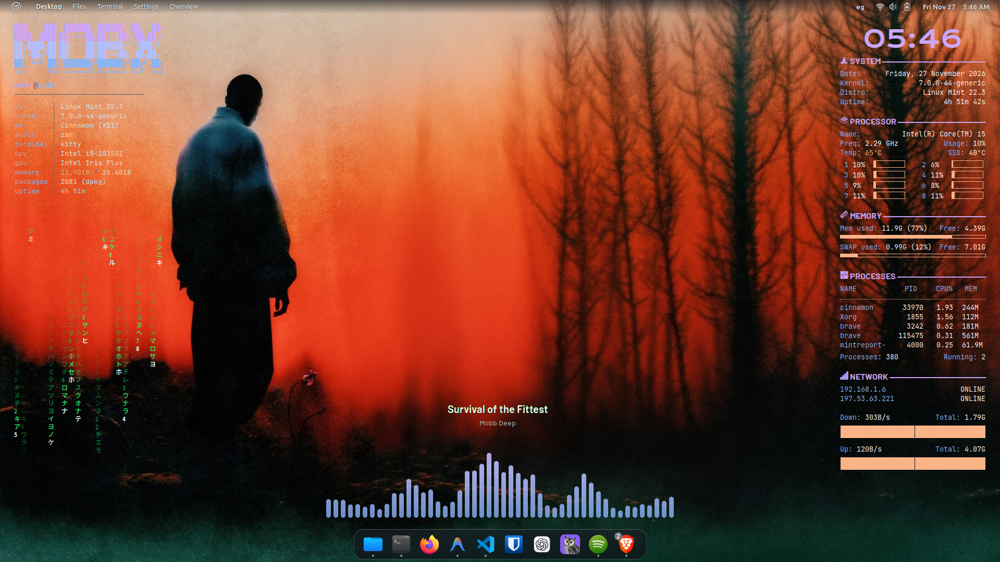

<div align="center">

# cinnamon-glass

**A dark glassmorphism desktop rice for Linux Mint Cinnamon (X11)**  
Adaptive top bar · Floating glass dock · Custom GJS extensions · Live Conky/Cava HUD · Rofi Spotlight

<p>
  
  
  
  
  
</p>

<br />



<details>
  <summary>Wallpaper preview (<code>wallpaper.jpg</code>)</summary>
  <br />
  
</details>

</div>

> [!WARNING]
> **AI-Assisted Configuration — Install with Care**
>
> All scripts, custom Cinnamon extensions, applets, themes, and Conky/Rofi configurations in this repository were built and tuned **with AI assistance** for a **Linux Mint 22.3 Cinnamon (X11)** setup.
>
> - **Be cautious before running automated scripts:** review `install.sh` and `extras/setup_login_screen.sh` first so you do not accidentally break your panels, GTK settings, display manager, or workflow.
> - **Take a backup first:** create a **Timeshift** snapshot before modifying system/login files. `install.sh` also creates an automatic desktop backup in `~/.dotfiles-backup/`.
> - **Ask an AI assistant for help during setup:** if you are on a different distro, Cinnamon version, monitor layout, or audio/network setup, paste the relevant files or errors into an AI coding assistant to adapt them safely before applying.

---

## Table of Contents

1. [What's Included](#whats-included)
2. [Requirements & Compatibility](#requirements--compatibility)
3. [Step-by-Step Installation](#step-by-step-installation)
4. [Manual Installation (Optional)](#manual-installation-optional)
5. [How to Run & Manage](#how-to-run--manage)
6. [Customization & Troubleshooting](#customization--troubleshooting)
7. [Shortcuts](#shortcuts)
8. [Uninstall & Rollback](#uninstall--rollback)
9. [License](#license)

---

## What's Included

| Module | Repo Path | Target Location | What It Does |
| :--- | :--- | :--- | :--- |
| **Cinnamon Theme** | `themes/Mint-Y-Dark-Grey-Clean/` | `~/.themes/Mint-Y-Dark-Grey-Clean` | Dark glass top bar, floating dock, clean menus & dialogs |
| **GTK3 Overrides** | `themes/gtk-3.0/gtk.css` | `~/.config/gtk-3.0/gtk.css` | Clean Nemo sidebar spacing + minimal macOS-style lock screen |
| **Fonts & Sound** | `assets/fonts/`, `assets/sounds/` | `~/.local/share/fonts/cinnamon-glass`, `~/.local/share/sounds/` | `Barlow`, `JetBrains Mono`, `Hack`, `ConkySymbols`, `ConkyWeather`, `KronaOne`, custom notification chime |
| **GJS Extensions** | `cinnamon/extensions/` | `~/.local/share/cinnamon/extensions/` | `adaptive-topbar@local`, `rounded-corners@local`, `panel-fluid-menus@local` |
| **Custom Applets** | `cinnamon/applets/` | `~/.local/share/cinnamon/applets/` | `macos-menubar@local` & `control-center@local` |
| **Panel Spices** | `cinnamon/spices/` | `~/.config/cinnamon/spices/` | Mint ring menu logo, 12h date/time format, centered dock (preserves your pinned apps) |
| **Rofi Spotlight** | `rofi/` | `~/.config/rofi/` | Dark glass launcher bound to `Alt + Space` with native `Super + Space` layout switching |
| **Conky / Cava HUD** | `conky/` | `~/.conky/`, `~/.config/systemd/user/`, `~/.config/autostart/` | Right monitor panel, top-left ASCII Fetch, bottom-left Matrix Rain, bottom-center Cava 48-bar visualizer + PangoCairo Arabic/English Now Playing |
| **Login Screen** *(optional)* | `extras/setup_login_screen.sh` | `/etc/lightdm/slick-greeter.conf` | Clean centered Slick Greeter + top-center lock screen clock |

---

## Requirements & Compatibility

- **OS:** Linux Mint 21.x / 22.x (tested on **Linux Mint 22.3 Zena**)
- **Desktop / Display Server:** **Cinnamon on X11** *(custom GLSL shaders, `wmctrl`, `xprop`, and Rofi focus tracking require X11 — not Wayland)*.
- **Packages** (installed automatically by `./install.sh` unless `--no-deps` is passed):
  - **Core:** `git`, `curl`, `unzip`, `x11-utils`, `wmctrl`, `bibata-cursor-theme`, `fonts-noto-kufi-arabic`, `fonts-ubuntu`
  - **Launcher:** `rofi`
  - **Conky / Matrix / Cava:** `conky-all`, `cava`, `lm-sensors`, `fonts-noto-cjk`, `python3-gi`, `python3-gi-cairo`, `gir1.2-pango-1.0`
  - **Icons:** `kora` icon theme (automatically cloned from [`bikass/kora`](https://github.com/bikass/kora) into `~/.icons/kora` if not already installed)

---

## Step-by-Step Installation

### Step 1 — Verify Your Session & Create a Backup
Open your terminal and confirm you are running **Cinnamon on X11**:

```bash
echo "Desktop: $XDG_CURRENT_DESKTOP | Session: $XDG_SESSION_TYPE"
```

Expected output contains `Cinnamon` and `x11`.  
*(Recommended)* Create a **Timeshift** snapshot before installing (especially if you plan to run `--login`):

```bash
sudo timeshift --create --comments "Before cinnamon-glass"
```

### Step 2 — Clone the Repository

```bash
git clone https://github.com/mobx2/cinnamon-glass.git
cd cinnamon-glass
```

### Step 3 — Run the Installer

#### Option A: Interactive Menu (Recommended for First-Time Users)

```bash
./install.sh
```

You will be prompted to pick one of 5 modes:
1. **Full desktop setup** (Theme + Cinnamon + Rofi + Conky HUD)
2. **Desktop theme, extensions & panels only**
3. **Rofi Spotlight launcher only**
4. **Conky HUD only** (ASCII Fetch + Matrix Rain + Cava + Panel)
5. **Full setup + Login/Lock screen** *(uses `sudo`)*

#### Option B: Direct CLI Flags (Modular)

```bash
# Install everything (Desktop + Rofi + Conky HUD)
./install.sh --all

# Or install individual modules one by one
./install.sh --desktop       # Theme, GTK CSS, fonts, icons, extensions, applets & panels
./install.sh --rofi          # Rofi Spotlight config + Alt+Space keybinding
./install.sh --conky         # All 4 Conky widgets + Cava/MPRIS bridge + autostart

# Skip apt installation if you already have the packages installed
./install.sh --all --no-deps -y
```

> **What `install.sh` automatically adapts for your machine:**
> - Saves a full snapshot of your existing Cinnamon `dconf`, `gtk.css`, `rofi`, `conky`, and `spices` into `~/.dotfiles-backup/<timestamp>/`.
> - Preserves your existing dock `pinned-apps` (or filters default pinned apps to ones actually installed on your PC).
> - Detects your active network interface (`ip route`), CPU thermal sensor (`coretemp` / `k10temp` / `zenpower` / `acpitz`), optional NVMe sensor, and logical CPU core count for the right-side Conky panel.

### Step 4 — Reload Cinnamon (or Log Out & Back In)
To make sure all custom extensions, applets, fonts, and GTK styles load cleanly:
- Press **`Alt + F2`**, type **`r`**, and press **`Enter`** (or **Log Out** and **Log Back In**).

### Step 5 — Optional: Login & Lock Screen Setup
If you want the matching centered **LightDM Slick Greeter** login screen and top-center lock screen clock:

```bash
# Single monitor / keep existing monitor layout
sudo bash extras/setup_login_screen.sh

# Optional: force dual-monitor primary (left) & secondary (right) order on LightDM
sudo bash extras/setup_login_screen.sh --dual-monitor HDMI-1 eDP-1
```

*(Replace `HDMI-1` and `eDP-1` with your actual outputs from `xrandr --query`.)*

---

## Manual Installation (Optional)

<details>
<summary>Click to expand step-by-step manual setup (if you prefer not to run <code>install.sh</code>)</summary>

1. **Install required packages:**
   ```bash
   sudo apt update
   sudo apt install -y git curl unzip x11-utils wmctrl bibata-cursor-theme \
     fonts-ubuntu fonts-noto-cjk fonts-noto-kufi-arabic \
     rofi conky-all cava lm-sensors python3-gi python3-gi-cairo gir1.2-pango-1.0
   ```
2. **Install fonts, sound & wallpaper:**
   ```bash
   mkdir -p ~/.local/share/fonts/cinnamon-glass ~/.local/share/sounds ~/Pictures/Wallpapers
   cp -r assets/fonts/* ~/.local/share/fonts/cinnamon-glass/
   fc-cache -f ~/.local/share/fonts/cinnamon-glass
   cp assets/sounds/custom-notification.oga ~/.local/share/sounds/
   cp wallpaper.jpg ~/Pictures/Wallpapers/cinnamon-glass.jpg
   ```
3. **Install theme, GTK3 CSS & Kora icons:**
   ```bash
   mkdir -p ~/.themes ~/.config/gtk-3.0 ~/.icons
   cp -a themes/Mint-Y-Dark-Grey-Clean ~/.themes/
   cat themes/gtk-3.0/gtk.css >> ~/.config/gtk-3.0/gtk.css
   git clone --depth=1 https://github.com/bikass/kora.git /tmp/kora && cp -r /tmp/kora/kora ~/.icons/ && rm -rf /tmp/kora
   ```
4. **Install Cinnamon extensions & applets:**
   ```bash
   mkdir -p ~/.local/share/cinnamon/{extensions,applets}
   cp -r cinnamon/extensions/* ~/.local/share/cinnamon/extensions/
   cp -r cinnamon/applets/* ~/.local/share/cinnamon/applets/
   ```
5. **Install Rofi Spotlight:**
   ```bash
   mkdir -p ~/.config/rofi
   cp rofi/* ~/.config/rofi/
   chmod +x ~/.config/rofi/launch.sh
   ```
   Bind `~/.config/rofi/launch.sh` to `Alt + Space` in **System Settings → Keyboard → Shortcuts → Custom Shortcuts**.
6. **Install Conky HUD & systemd user units:**
   ```bash
   mkdir -p ~/.conky ~/.config/systemd/user ~/.config/autostart
   cp -r conky/{ascii-fetch,matrix-rain,cava-bar,panel} ~/.conky/
   cp conky/conky-startup.sh ~/.conky/
   cp conky/autostart/conky.desktop ~/.config/autostart/
   cp conky/systemd/dotfiles-conky-*.service ~/.config/systemd/user/
   chmod +x ~/.conky/conky-startup.sh ~/.conky/cava-bar/run.sh
   systemctl --user daemon-reload
   ~/.conky/conky-startup.sh
   ```

</details>

---

## How to Run & Manage

### 1. Rofi Spotlight Launcher
- Press **`Alt + Space`** to toggle Spotlight open/closed.
- Switch modes with `Ctrl + Tab` (`Apps`, `Run`, `Windows`, `Files`).
- Press **`Super + Space`** inside the search box to switch keyboard layouts (works natively because `launch.sh` uses `-normal-window`), or click outside to close.
- Manual launch test:
  ```bash
  ~/.config/rofi/launch.sh
  ```

### 2. Conky Widgets, Matrix Rain & Cava Visualizer
At login, `~/.config/autostart/conky.desktop` runs `~/.conky/conky-startup.sh` after a short 4-second delay (avoiding boot race conditions) to launch the right monitor panel and restart the three systemd user widgets:

```bash
# Start or restart all 4 Conky widgets cleanly
~/.conky/conky-startup.sh

# Check live status of the 3 widget services
systemctl --user status dotfiles-conky-ascii.service dotfiles-conky-matrix.service dotfiles-conky-cava.service

# Restart or stop a specific widget
systemctl --user restart dotfiles-conky-cava.service
systemctl --user stop dotfiles-conky-matrix.service
```

### 3. Reloading Cinnamon Extensions
```bash
dbus-send --session --dest=org.Cinnamon --type=method_call /org/Cinnamon org.Cinnamon.ReloadXlet string:'adaptive-topbar@local' string:'EXTENSION'
```

---

## Customization & Troubleshooting

- **Change the ASCII banner text (Top-Left):** edit lines 55–60 in `~/.conky/ascii-fetch/conkyrc.conf`.
- **Network shows `OFFLINE` on the right panel:** check your active interface with `ip -br link` and replace the interface name in `~/.conky/panel/conkyrc.conf`.
- **Cava bars or Now Playing don't appear:**
  - The Cava HUD is intentionally **invisible when no audio is playing**. Start Spotify or any MPRIS2 media player.
  - Verify Cava reads your PipeWire/PulseAudio monitor cleanly (`method = pulse`, `source = auto` in `~/.conky/cava-bar/cava.conf`).
  - Inspect logs with: `journalctl --user -u dotfiles-conky-cava.service -n 30 --no-pager`
- **Matrix Rain shows missing boxes instead of Katakana:** make sure `fonts-noto-cjk` is installed and run `fc-cache -f`.
- **Dual-monitor widget placement:** all Conky widgets use `xinerama_head = 0` (primary monitor). Change `xinerama_head` in their `conkyrc.conf` files if you want them on another display.
- **`Alt + Space` opens the window menu instead of Rofi:** run:
  ```bash
  gsettings set org.cinnamon.desktop.keybindings.wm activate-window-menu "[]"
  ```

---

## Shortcuts

| Shortcut | Action |
| :--- | :--- |
| `Alt + Space` | Toggle Rofi Spotlight launcher |
| `Super + Space` | Switch keyboard layout (works inside Rofi too) |
| `Super + D` / Bottom-Right Hot Corner | Smooth Desktop Peek / Restore |
| `Alt + F2` → `r` → `Enter` | Restart Cinnamon desktop shell |

---

## Uninstall & Rollback

### 1. Restore Your Desktop Settings
`uninstall.sh` stops and removes the Conky services, strips only the tagged `cinnamon-glass` block from `~/.config/gtk-3.0/gtk.css`, and restores your most recent `~/.dotfiles-backup/` snapshot:

```bash
./uninstall.sh
```

Then restart Cinnamon (`Alt + F2` → `r` → `Enter`) or log out and back in.

### 2. Revert Optional Login/Lock Screen Tweaks (Only if You Ran `--login`)
```bash
sudo bash -c '[ -f /usr/share/cinnamon-screensaver/clock.py.bak ] && mv /usr/share/cinnamon-screensaver/clock.py.bak /usr/share/cinnamon-screensaver/clock.py'
sudo bash -c '[ -f /etc/lightdm/slick-greeter.conf.bak ] && mv /etc/lightdm/slick-greeter.conf.bak /etc/lightdm/slick-greeter.conf'
```
*(Or restore the **Timeshift** snapshot you created in Step 1.)*

---

## License

This project is licensed under the **MIT License** — see [`LICENSE`](./LICENSE) for details.

---

<div align="center">
  <sub>Crafted by <a href="https://github.com/mobx2">@mobx2</a></sub>
</div>
